<div align="center">

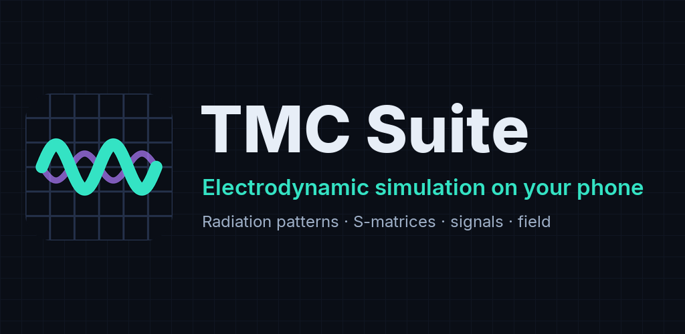

# TMC Suite for Android

**Electrodynamic simulation of planar structures on your phone**

C++ · Qt 6 · Qt RHI · Android 9+ (arm64-v8a)

**English** · [Русский](#tmc-suite-для-android-русская-версия)

</div>

---

> **This is an alpha version, 0.1.0-alpha4.** It is the first public release of the app.

## Overview

**TMC Suite** is an authorial scientific software package by **K. N. Klimov** for electrodynamic
computation and visualization of planar structures (H-polarization and X-mode).

This repository is the **Android edition**: one app in place of the desktop programs. It calculates
`.tpl` tasks on the phone itself, shows the results and needs no internet connection. It is meant for
small tasks and for viewing results on the go. Large calculations are more convenient on a computer.

| Desktop program | In the app | What it does |
|---|---|---|
| PlanarRT_H | Kernel H | Calculation, H-polarization |
| PlanarRT_X | Kernel X | Calculation, X-mode, including plasma: density, magnetization, losses |
| TMCGROUT | S-matrix chart | \|S\|, losses in dB, VSWR, phase over frequency |
| TMC_DN | Pattern chart | Radiation pattern in Cartesian and polar coordinates, directivity |
| TMCROS | Signals chart | Port signals over time |
| FieldView | Field screen | Field step by step in 3D, on Qt RHI |
| TPL Designer | TPL Designer tab | Build a task without typing: domain, geometry, materials, ports, signals, checks, sample library |

Also in the app:

- calculation in the background and with the screen off, with progress and a **Stop** button in the
  notification;
- comparison of several calculations on one chart;
- your own task folders, sharing and deleting results;
- a built-in user guide with screenshots, English and Russian interface.

## Screenshots

| Task editor | Calculation | Radiation pattern |
|---|---|---|
| 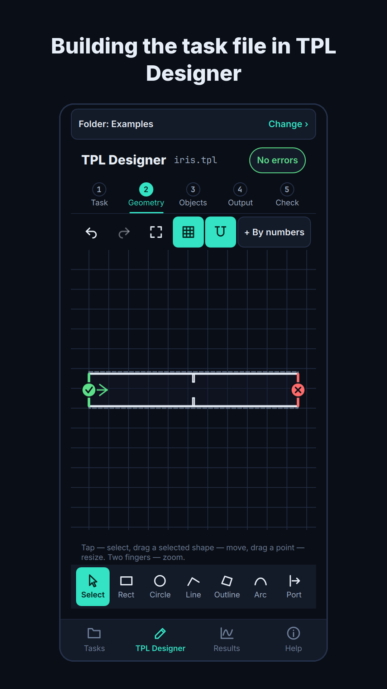 | 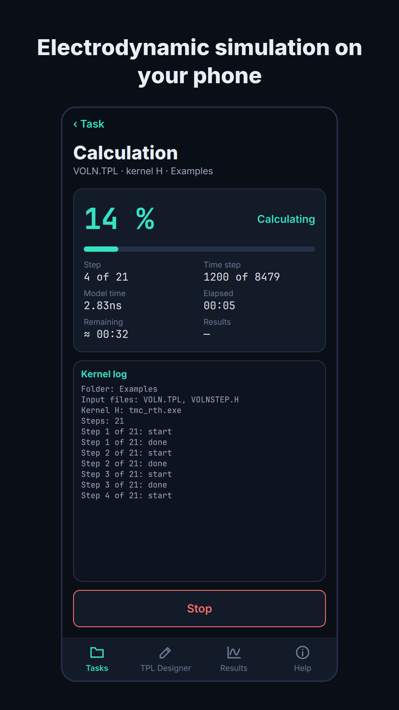 | 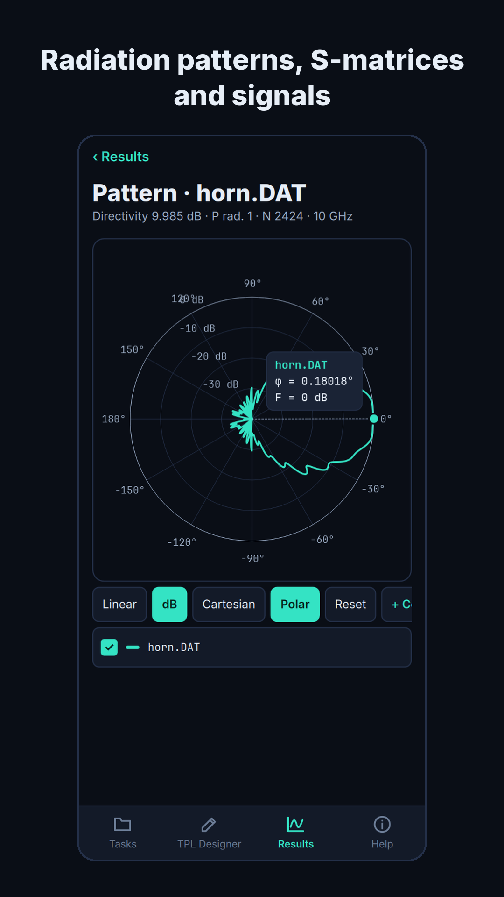 |

| Comparing calculations | Field | Results |
|---|---|---|
| 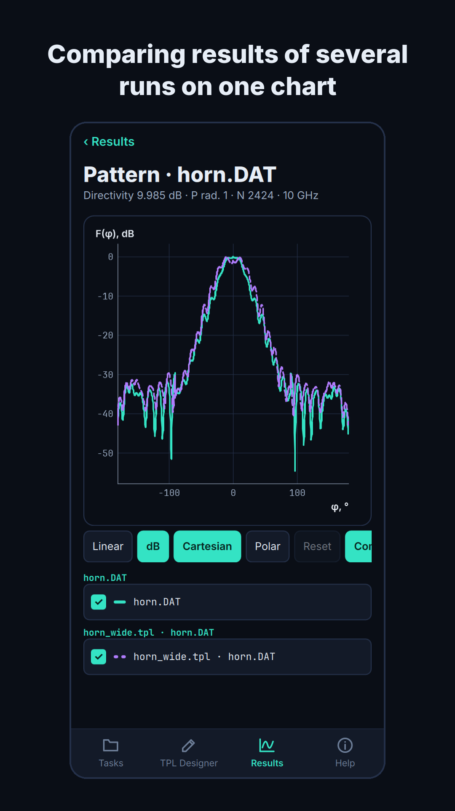 | 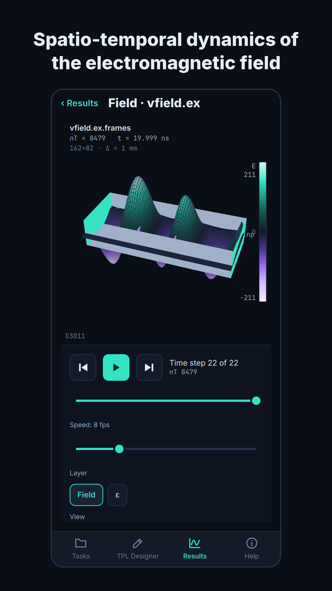 | 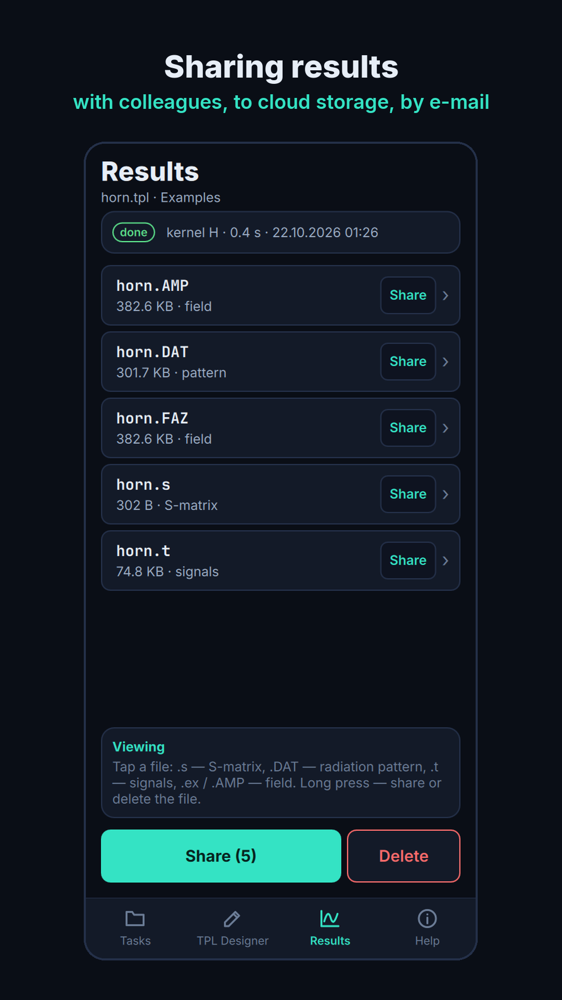 |

The screenshots are taken with the desktop build of the same app, so the kernel log and the graphics
line differ slightly from what a phone shows.

## Installation

The APK is in [Releases](../../releases). The app is also under review in app stores; links will appear
here once it is approved.

| Requirement | Value |
|---|---|
| System | Android 9 or newer |
| Processor | 64-bit ARM (arm64-v8a); 32-bit devices are not supported |
| Memory | 4 GB of RAM or more, 8 GB or more for comfortable work |
| Download size | about 31 MB |

1. Download `TMC-Suite-0.1.0-alpha4-arm64-v8a.apk` on the phone and open it.
2. Android asks for permission to install from this source. Allow it for your browser and go back.
3. If Google Play Protect warns about an unknown developer, choose **More details → Install anyway**.
4. After the installation you can switch the permission off again.

A copy from a store and a copy from this page can be signed with different keys. To switch between them,
remove the installed app first.

Compare the file with `SHA256SUMS.txt` from the release if you want to check it. The certificate of
the APK is `CN=TMC Suite upload, O=TAMIC, C=RU`, SHA-256
`446a532425cfe31c6d3b577a7aa66b0893039a2880b65bfa42c1633dcf6b3660`.

## Privacy

The app has no network permission, no ads and no analytics. It collects nothing. Tasks and results stay
on the phone until you share them yourself. It asks for three things only: notifications, a foreground
service and a wake lock, so that a calculation keeps running with the screen off.

## Known limitations

- **Windows edition.** Results of this version do not yet match the Windows edition 5.0 in every case.
  The next update will bring them in line. File formats are the same.
- **Pinch gesture.** On charts, in the field and in the geometry view a curve can jump aside during a
  pinch, and the field can turn.
- **TPL Designer** has no page for several `#STEP` blocks with different active ports and for choosing
  the S-matrix columns.
- **Task size.** A grid takes about 32 bytes per node in kernel H and 96 bytes per node in kernel X.
  Grids of a million nodes and more have not been measured on a phone.

## Input format

Tasks are text files in the `.tpl` language, the same as in the desktop editions:
[`.tpl` language reference](https://www.tamic.ru/docs/user-manual/tpl-guide.html).

## Building

The build runs on Windows. The Android app needs a desktop Qt as well, because the host tools come from
it.

| Tool | Version |
|---|---|
| Qt | 6.11.1: `mingw_64` and `android_arm64_v8a`, in `C:\Qt\6.11.1` |
| CMake, Ninja | from the Qt kit, in `C:\Qt\Tools` |
| JDK | 21, in the `JAVA_HOME` variable |
| Android SDK | `platforms;android-36`, `build-tools;36.0.0`, in `%LOCALAPPDATA%\Android\Sdk` |
| Android NDK | 27.2.12479018, the version Qt 6.11 is built with |

If Qt is somewhere else, change `QT_ROOT` and `QT_TOOLS` in `CMakePresets.json`.

```powershell
$cmake = "C:\Qt\Tools\CMake_64\bin\cmake.exe"

# APK with a debug signature, ready to install
& $cmake --preset android-arm64
& $cmake --build --preset android-arm64

# release APK, not signed
& $cmake --preset android-arm64-release
& $cmake --build --preset android-arm64-release --target apk
```

The first build takes about 15 minutes because Gradle downloads itself and its plugins. The APK is in
`build\<preset>\src\app\android-build\build\outputs\apk\`.

To sign a release, set `QT_ANDROID_KEYSTORE_PATH`, `QT_ANDROID_KEYSTORE_ALIAS`,
`QT_ANDROID_KEYSTORE_STORE_PASS` and `QT_ANDROID_KEYSTORE_KEY_PASS`, then configure with
`-DQT_ANDROID_SIGN_APK=ON`. Keep the key outside the repository.

The `desktop` preset builds the same app for Windows with MinGW. It is handy for debugging the interface
and the kernels without a phone.

## Repository layout

| Folder | Contents |
|---|---|
| `src/app` | App: screens (QML), task storage, kernel launch, built-in guide, examples, fonts |
| `src/kernels` | Build of the kernels for Android, compatibility layer |
| `src/win_src` | Computational code of the Windows edition, the files the kernels are built from |
| `src/viewers` | Charts: S-matrix, radiation pattern, signals |
| `src/fieldview` | Field on Qt RHI, shaders |
| `src/tpl_designer` | TPL Designer |
| `src/ui` | Design tokens shared by the screens |
| `platforms/android` | Manifest, Java service for the calculation, icons |
| `i18n` | English translation |

## Other systems

| System | Repository |
|---|---|
| Windows | [TMC_Suite](https://github.com/klimov-kn/TMC_Suite) |
| macOS | [TMC_Suite_MacOS](https://github.com/klimov-kn/TMC_Suite_MacOS) |
| Linux with a graphical interface | [TMC_Suite_Linux_GUI](https://github.com/klimov-kn/TMC_Suite_Linux_GUI) |
| Linux, console kernels | [TMC_Suite_Linux_Console](https://github.com/klimov-kn/TMC_Suite_Linux_Console) |

## Author & links

- **Author:** K. N. Klimov and the TAMIC group
- **Website:** [www.tamic.ru](https://www.tamic.ru)

## License

[Apache License 2.0](LICENSE). See also [`NOTICE`](NOTICE). If you publish results obtained with the
app, please cite the authors and the project.

The sources in this repository are under Apache 2.0. The **Help → Licenses** screen of build 0.1.0-alpha4
still shows the earlier license text of the project; the next build will show the new one.

---

<div align="center">

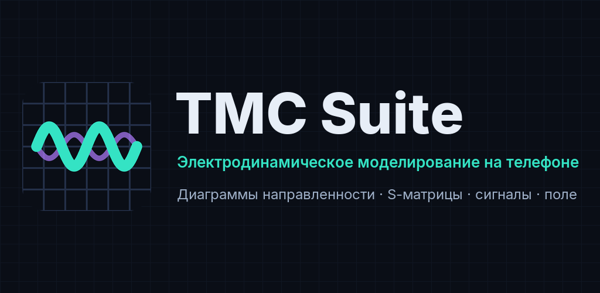

# TMC Suite для Android (русская версия)

**Электродинамический расчёт планарных структур на телефоне**

C++ · Qt 6 · Qt RHI · Android 9+ (arm64-v8a)

[English](#tmc-suite-for-android) · **Русский**

</div>

---

> **Это альфа-версия 0.1.0-alpha4**, первый публичный выпуск приложения.

## О проекте

**TMC Suite** — авторский научный пакет программ **К. Н. Климова** для электродинамических расчётов и
визуализации планарных структур (H-поляризация и X-мода).

Этот репозиторий — **версия для Android**: одно приложение вместо настольных программ. Оно считает
задания `.tpl` прямо на телефоне, показывает результаты и не требует интернета. Приложение рассчитано
на небольшие задачи и просмотр результатов в дороге; большие расчёты удобнее вести на компьютере.

| Настольная программа | В приложении | Что делает |
|---|---|---|
| PlanarRT_H | Ядро H | Расчёт, H-поляризация |
| PlanarRT_X | Ядро X | Расчёт, X-мода, включая плазму: плотность, намагниченность, потери |
| TMCGROUT | График S-матрицы | \|S\|, потери в дБ, КСВН, фаза по частоте |
| TMC_DN | График ДН | Диаграмма направленности в декартовых и полярных координатах, КНД |
| TMCROS | График сигналов | Сигналы на портах во времени |
| FieldView | Экран «Поле» | Поле по тактам в 3D, на Qt RHI |
| TPL Designer | Вкладка TPL Designer | Задание без набора текста: область, геометрия, материалы, порты, сигналы, проверки, библиотека образцов |

Ещё в приложении:

- расчёт в фоне и с выключенным экраном, ход и кнопка **«Остановить»** в уведомлении;
- сравнение нескольких расчётов на одном графике;
- свои папки заданий, отправка и удаление результатов;
- встроенное руководство со снимками, интерфейс на русском и английском.

## Скриншоты

| Редактор заданий | Расчёт | Диаграмма направленности |
|---|---|---|
| 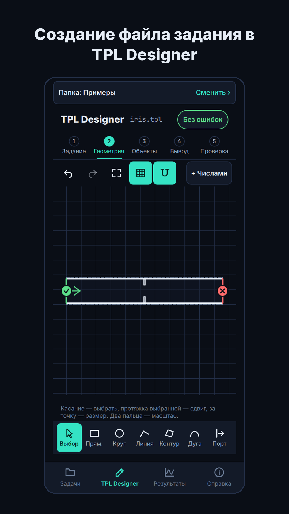 | 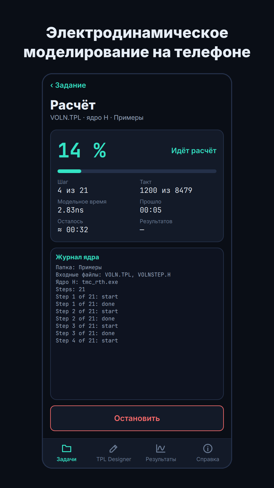 | 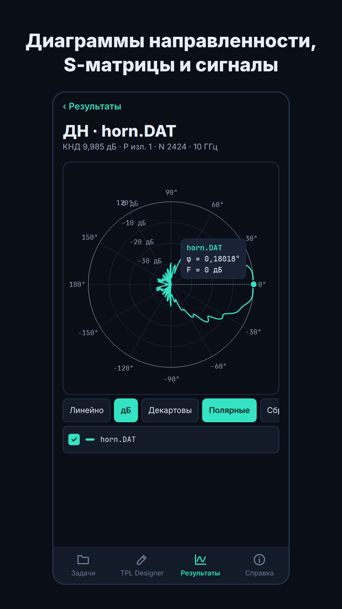 |

| Сравнение расчётов | Поле | Результаты |
|---|---|---|
| 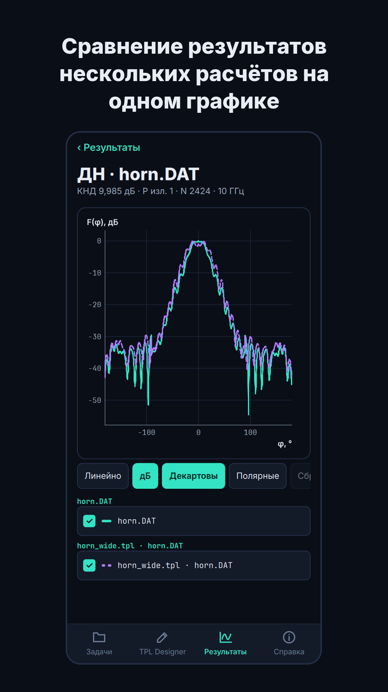 | 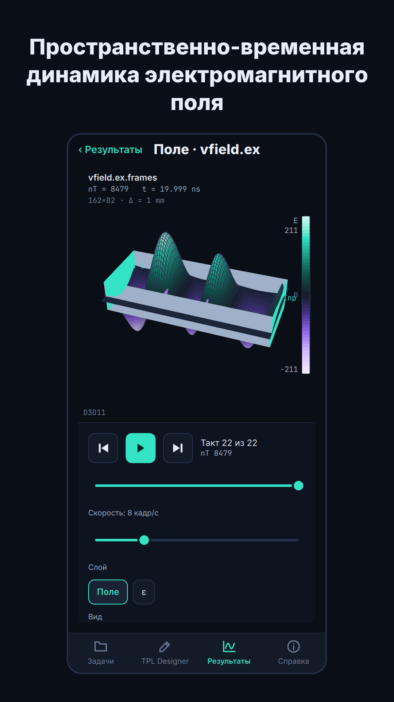 | 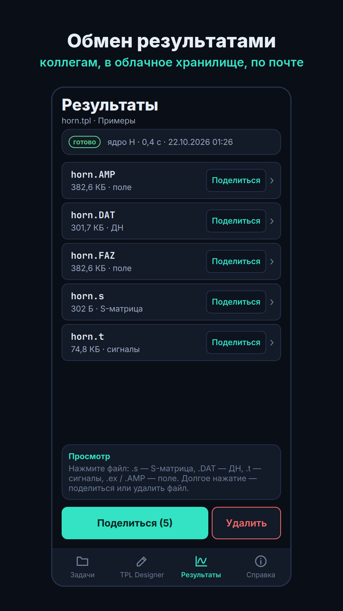 |

Снимки сделаны настольной сборкой того же приложения, поэтому журнал ядра и строка о графике немного
отличаются от того, что покажет телефон.

## Установка

Файл APK лежит в [Releases](../../releases). Приложение также проходит проверку в магазинах; ссылки
появятся здесь после одобрения.

| Требование | Значение |
|---|---|
| Система | Android 9 и новее |
| Процессор | 64-битный ARM (arm64-v8a); 32-битные устройства не поддерживаются |
| Память | от 4 ГБ оперативной памяти, комфортно — от 8 ГБ |
| Размер файла | около 31 МБ |

1. Скачайте на телефон файл `TMC-Suite-0.1.0-alpha4-arm64-v8a.apk` и откройте его.
2. Android попросит разрешение на установку из этого источника. Разрешите его для браузера и вернитесь
   назад.
3. Если Google Play Защита предупредит о неизвестном разработчике, выберите **«Подробнее» → «Всё равно
   установить»**.
4. После установки разрешение можно снова выключить.

Копия из магазина и копия с этой страницы могут быть подписаны разными ключами. Чтобы перейти с одной на
другую, сначала удалите установленное приложение.

Файл можно проверить по `SHA256SUMS.txt` из выпуска. Сертификат APK: `CN=TMC Suite upload, O=TAMIC, C=RU`,
SHA-256 `446a532425cfe31c6d3b577a7aa66b0893039a2880b65bfa42c1633dcf6b3660`.

## Конфиденциальность

У приложения нет разрешения на доступ к сети, нет рекламы и аналитики. Оно ничего не собирает. Задания и
результаты остаются на телефоне, пока вы сами их не отправите. Разрешения всего три: уведомления, служба
переднего плана и блокировка сна, чтобы расчёт шёл при выключенном экране.

## Известные ограничения

- **Windows-версия.** Результаты этой версии пока совпадают с Windows-версией 5.0 не во всех случаях.
  Следующее обновление устранит расхождения. Форматы файлов те же.
- **Жест щипка.** На графиках, в поле и в геометрии кривая при щипке может смещаться в сторону, а поле
  поворачиваться.
- **TPL Designer** пока не умеет несколько блоков `#STEP` с разными активными портами и выбор столбцов
  S-матрицы.
- **Размер задачи.** Сетка занимает около 32 байт на узел в ядре H и 96 байт на узел в ядре X. Сетки от
  миллиона узлов на телефоне не замерялись.

## Формат входных данных

Задания — текстовые файлы на языке `.tpl`, тот же формат, что в настольных версиях:
[справочник языка `.tpl`](https://www.tamic.ru/docs/user-manual/tpl-guide.html).

## Сборка

Сборка идёт на Windows. Приложению для Android нужен и настольный Qt: из него берутся инструменты сборки.

| Инструмент | Версия |
|---|---|
| Qt | 6.11.1: `mingw_64` и `android_arm64_v8a`, в `C:\Qt\6.11.1` |
| CMake, Ninja | из комплекта Qt, в `C:\Qt\Tools` |
| JDK | 21, в переменной `JAVA_HOME` |
| Android SDK | `platforms;android-36`, `build-tools;36.0.0`, в `%LOCALAPPDATA%\Android\Sdk` |
| Android NDK | 27.2.12479018, той же версией собран Qt 6.11 |

Если Qt лежит в другом месте, поменяйте `QT_ROOT` и `QT_TOOLS` в `CMakePresets.json`.

```powershell
$cmake = "C:\Qt\Tools\CMake_64\bin\cmake.exe"

# APK с отладочной подписью, готов к установке
& $cmake --preset android-arm64
& $cmake --build --preset android-arm64

# выпускной APK без подписи
& $cmake --preset android-arm64-release
& $cmake --build --preset android-arm64-release --target apk
```

Первая сборка идёт около 15 минут: Gradle скачивает себя и свои модули. Готовый APK лежит в
`build\<пресет>\src\app\android-build\build\outputs\apk\`.

Чтобы подписать выпуск, задайте `QT_ANDROID_KEYSTORE_PATH`, `QT_ANDROID_KEYSTORE_ALIAS`,
`QT_ANDROID_KEYSTORE_STORE_PASS` и `QT_ANDROID_KEYSTORE_KEY_PASS`, затем выполните настройку с ключом
`-DQT_ANDROID_SIGN_APK=ON`. Храните ключ вне репозитория.

Пресет `desktop` собирает то же приложение для Windows через MinGW. Это удобно для отладки интерфейса и
ядер без телефона.

## Структура репозитория

| Папка | Что внутри |
|---|---|
| `src/app` | Приложение: экраны (QML), хранение заданий, запуск ядер, встроенное руководство, примеры, шрифты |
| `src/kernels` | Сборка ядер для Android, слой совместимости |
| `src/win_src` | Расчётный код Windows-версии: файлы, из которых собираются ядра |
| `src/viewers` | Графики: S-матрица, диаграмма направленности, сигналы |
| `src/fieldview` | Поле на Qt RHI, шейдеры |
| `src/tpl_designer` | TPL Designer |
| `src/ui` | Общие параметры оформления экранов |
| `platforms/android` | Манифест, служба расчёта на Java, значки |
| `i18n` | Английский перевод |

## Другие системы

| Система | Репозиторий |
|---|---|
| Windows | [TMC_Suite](https://github.com/klimov-kn/TMC_Suite) |
| macOS | [TMC_Suite_MacOS](https://github.com/klimov-kn/TMC_Suite_MacOS) |
| Linux с графическим интерфейсом | [TMC_Suite_Linux_GUI](https://github.com/klimov-kn/TMC_Suite_Linux_GUI) |
| Linux, консольные ядра | [TMC_Suite_Linux_Console](https://github.com/klimov-kn/TMC_Suite_Linux_Console) |

## Автор и ссылки

- **Автор:** К. Н. Климов и коллектив TAMIC
- **Сайт:** [www.tamic.ru](https://www.tamic.ru)

## Лицензия

[Apache License 2.0](LICENSE). См. также [`NOTICE`](NOTICE). Если вы публикуете результаты, полученные в
приложении, пожалуйста, процитируйте авторов и проект.

Исходники в этом репозитории распространяются по Apache 2.0. Экран **«Справка» → «Лицензии»** сборки
0.1.0-alpha4 ещё показывает прежний текст лицензии проекта; в следующей сборке будет новый.
